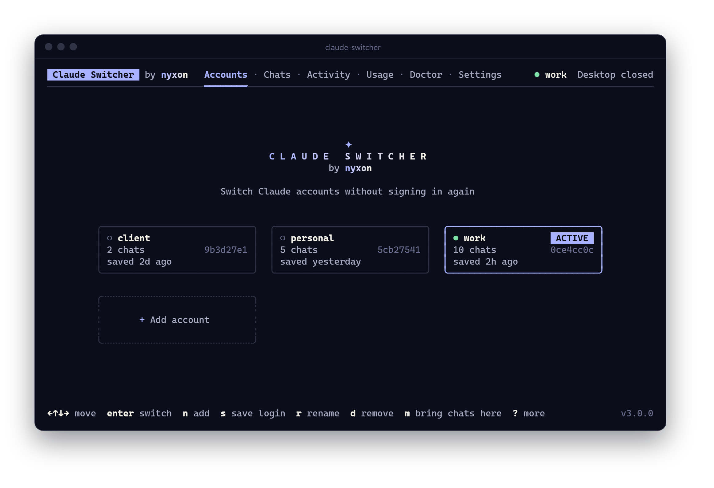
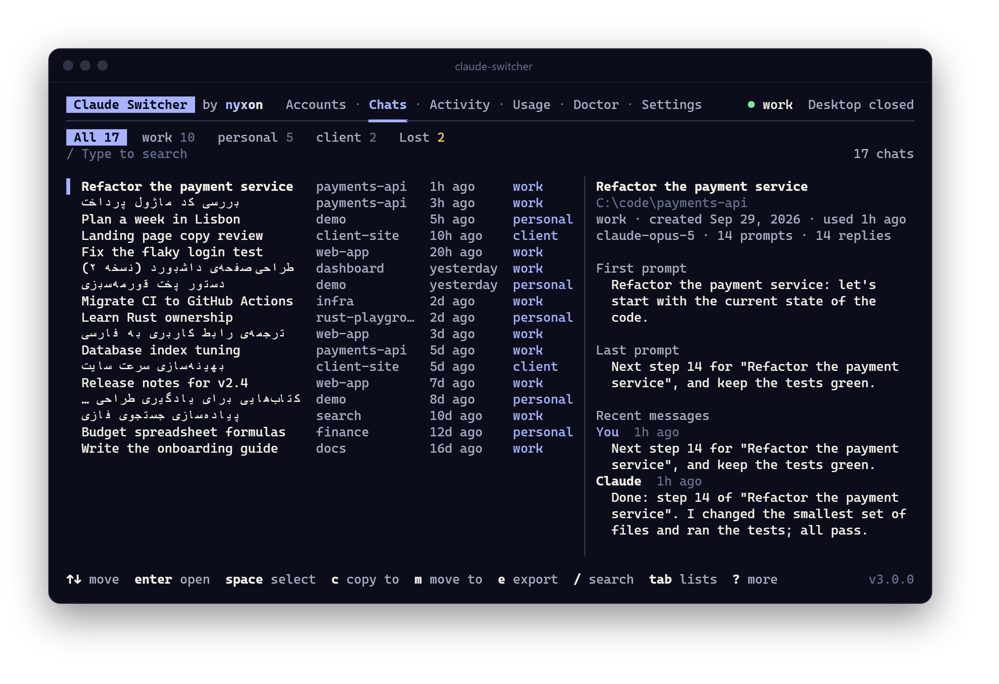
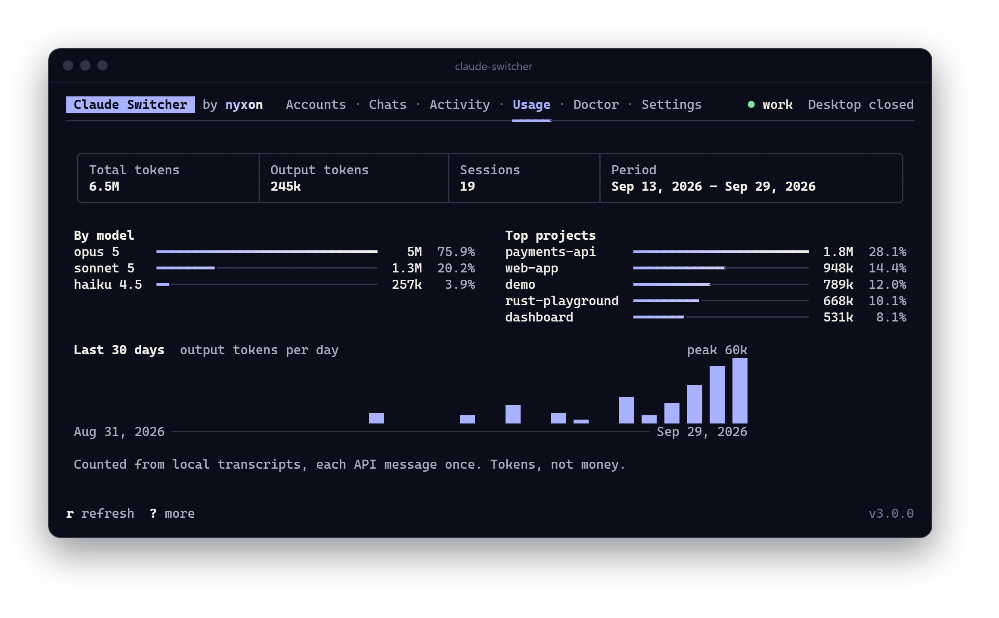
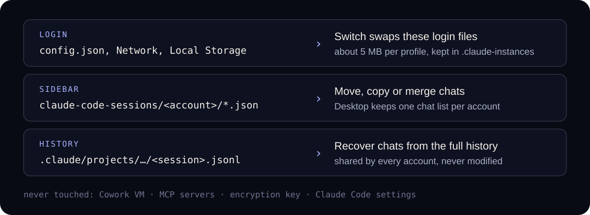

<p align="center">
  
</p>

<h1 align="center">Claude Switcher</h1>

<p align="center" dir="rtl">
  بین حساب‌های Claude Desktop بدون ورود دوباره جابه‌جا شوید،<br>
  و همه‌ی گفتگوهای Claude Code همیشه همراهتان باشد؛ روی ویندوز، macOS و لینوکس.
</p>

<p align="center">
  <a href="https://github.com/nyxon-tech/claude-switcher/releases/latest"></a>
  <a href="https://github.com/nyxon-tech/claude-switcher/actions/workflows/ci.yml"></a>
  
  <a href="./LICENSE"></a>
</p>

<p align="center">
  <a href="./README.md">English</a> &nbsp;·&nbsp; <b>فارسی</b>
</p>

<p align="center" dir="rtl">
  <a href="#نصب">نصب</a> &nbsp;·&nbsp;
  <a href="#هر-حساب-هر-گفتگو">گفتگوها</a> &nbsp;·&nbsp;
  <a href="#امکانات">امکانات</a> &nbsp;·&nbsp;
  <a href="#طرز-کار">طرز کار</a> &nbsp;·&nbsp;
  <a href="#ساخت-از-سورس">ساخت از سورس</a>
</p>

<div dir="rtl">

Claude Desktop هر بار فقط به یک حساب وارد است. عوض کردن حساب یعنی خروج و ورود دوباره، و هر حساب سایدبار Code مخصوص خودش را دارد؛ برای همین گفتگوهایی که یک دقیقه پیش داشتید انگار ناپدید شده‌اند.

**Claude Switcher** هر ورود را یک‌بار ذخیره می‌کند و در چند ثانیه بین آن‌ها جابه‌جا می‌شود. گفتگوهای Code همه‌ی حساب‌ها را یک‌جا نشان می‌دهد، آن‌ها را به حسابی که الان استفاده می‌کنید کپی یا منتقل می‌کند، گفتگوهایی را که از سایدبار افتاده‌اند برمی‌گرداند و هر کدام از این کارها را قابل بازگشت (Undo) می‌کند. فقط یک فایل اجرایی است و فقط به فایل‌های روی کامپیوتر خودتان دست می‌زند.

## نصب

**ویندوز** (PowerShell)

</div>

```powershell
irm https://raw.githubusercontent.com/nyxon-tech/claude-switcher/main/install.ps1 | iex
```

<div dir="rtl">

**macOS و لینوکس**

</div>

```sh
curl -fsSL https://raw.githubusercontent.com/nyxon-tech/claude-switcher/main/install.sh | sh
```

<div dir="rtl">

هر دو اسکریپت آخرین نسخه را دانلود می‌کنند، آن را با چک‌سام‌های SHA-256 منتشرشده تطبیق می‌دهند و فقط برای کاربر فعلی و بدون نیاز به دسترسی ادمین نصب می‌کنند. بعد <code dir="ltr">claude-switcher</code> را اجرا کنید. می‌توانید آرشیو را از [Releases](https://github.com/nyxon-tech/claude-switcher/releases/latest) هم دانلود کنید، یا با <code dir="ltr">go install github.com/nyxon-tech/claude-switcher/v3/cmd/claude-switcher@latest</code> بسازید.

از قبل نسخه‌ی v2 دارید؟ همان دستور را بزنید. ورودهای ذخیره‌شده‌ی شما در <code dir="ltr">~/.claude-instances</code> بدون تغییر منتقل می‌شوند.

## هر حساب، هر گفتگو

<p align="center">
  
</p>

تب Chats گفتگوهای Code همه‌ی حساب‌ها را کنار هم فهرست می‌کند. شروع به تایپ کنید تا عنوان‌ها و پروژه‌ها جست‌وجو شوند، پیش‌نمایش هر گفتگو را باز کنید، گفتگوها را با Space علامت بزنید و **کپی** کنید (در هر دو حساب دیده می‌شوند) یا **منتقل** کنید. اگر حساب مقصد از قبل آن گفتگو را داشته باشد، نسخه‌ی جدیدتر برنده است؛ پس گفتگویی که در یک حساب ادامه داده‌اید همراهتان می‌آید. هر گفتگو را می‌توانید به‌صورت صفحه‌ی وب یا Markdown خروجی بگیرید.

بخش **Lost** گفتگوهایی را نشان می‌دهد که تاریخچه‌شان هنوز روی دیسک هست اما در هیچ سایدبار دیده نمی‌شوند؛ مثلاً بعد از تعویض حساب، نصب دوباره یا آپدیت. آن‌ها را بازیابی کنید تا با عنوان، پروژه و تاریخ‌هایشان به Claude Desktop برگردند.

عنوان گفتگوهای فارسی، عربی و عبری درست نمایش داده می‌شود؛ حروف به هم چسبیده و راست‌به‌چپ، حتی در ترمینال‌هایی که خودشان از نوشتار راست‌به‌چپ پشتیبانی نمی‌کنند، مثل Windows Terminal.

## امکانات

| | |
| --- | --- |
| **تعویض حساب** | به یک ورود ذخیره‌شده‌ی دیگر می‌روید و Claude Desktop دوباره باز می‌شود. بدون رمز عبور، بدون کد ایمیل. |
| **افزودن حساب** | ورود فعلی را ذخیره می‌کند، بعد Desktop را بدون ورود باز می‌کند تا حساب بعدی را اضافه کنید؛ بی‌آنکه هرگز دکمه‌ی Log out را بزنید. |
| **کپی، انتقال، ادغام** | گفتگو به گفتگو بین هر دو حساب، یا آوردن همه‌ی گفتگوها به یک حساب. نسخه‌ی جدیدتر برنده است. |
| **بازیابی** | برای گفتگوهایی که فقط به‌صورت تاریخچه روی دیسک مانده‌اند، ورودی سایدبار را دوباره می‌سازد. |
| **بازگردانی (Undo)** | هر تغییر در گفتگوها همراه با پشتیبان ثبت می‌شود، پس Undo هر بایت را سر جایش برمی‌گرداند. |
| **مصرف** | توکن‌ها به تفکیک مدل، روز و پروژه، محاسبه‌شده از رونوشت‌های محلی خودتان. |
| **Doctor** | نصب، حساب واردشده و همه‌ی فهرست‌های گفتگو را بررسی می‌کند و درباره‌ی تنظیماتی که تاریخچه را پاک می‌کنند هشدار می‌دهد. |
| **قابل اسکریپت‌نویسی** | هر عمل یک دستور هم هست، با خروجی <code dir="ltr">--json</code> و کدهای خروج پایدار. |

<p align="center">
  
</p>

## طرز کار

Claude Desktop سه چیز را روی دیسک نگه می‌دارد و Claude Switcher با هر کدام جداگانه رفتار می‌کند.

<p align="center">
  
</p>

- **تعویض حساب** فایل‌های ورود Desktop (<code dir="ltr">config.json</code>، کوکی‌ها، local storage، چند مگابایت) را بین پوشه‌ی داده‌ی Desktop و <code dir="ltr">~/.claude-instances/&lt;profile&gt;</code> کپی می‌کند. برای این کار Desktop باید بسته باشد، چون هنگام خروج این فایل‌ها را دوباره می‌نویسد: Claude Switcher از آن می‌خواهد خارج شود (در ویندوز باید از آیکون سینی ببندیدش)، صبر می‌کند، فایل‌ها را عوض می‌کند و دوباره بازش می‌کند.
- **گفتگوها** در دو جا هستند. تاریخچه یک فایل برای هر مکالمه است که بین همه‌ی حساب‌ها مشترک است. سایدبار یک رکورد کوچک برای هر گفتگوست که برای هر حساب جداگانه نگه داشته می‌شود. کپی کردن گفتگو همان رکورد را کپی می‌کند؛ تاریخچه فقط خوانده می‌شود.
- **ایمنی.** پیش از ذخیره روی یک ورود، بررسی می‌کند که Desktop هنوز به همان حساب وارد باشد، وگرنه رد می‌کند. هر تغییر در گفتگوها اول همراه با پشتیبان ثبت می‌شود. رکوردها همان‌طور که Desktop انتظار دارد نوشته می‌شوند و فیلدهایی که نمی‌شناسد بایت‌به‌بایت حفظ می‌شوند. تنها درخواست شبکه، بررسی اختیاریِ روزانه برای نسخه‌ی جدید است.

</div>

<div dir="ltr">

| | Windows | macOS | Linux |
| --- | --- | --- | --- |
| Desktop data | <code dir="ltr">%LOCALAPPDATA%\Packages\Claude_pzs8sxrjxfjjc\LocalCache\Roaming\Claude</code> (or <code dir="ltr">%APPDATA%\Claude</code>) | <code dir="ltr">~/Library/Application Support/Claude</code> | <code dir="ltr">~/.config/Claude</code> |
| Chat history | <code dir="ltr">%USERPROFILE%\.claude\projects</code> | <code dir="ltr">~/.claude/projects</code> | <code dir="ltr">~/.claude/projects</code> |
| Saved logins | <code dir="ltr">%USERPROFILE%\.claude-instances</code> | <code dir="ltr">~/.claude-instances</code> | <code dir="ltr">~/.claude-instances</code> |

<details>
<summary><b>All commands</b></summary>

```text
claude-switcher                                 open the app
claude-switcher list                            saved accounts and chat lists
claude-switcher switch <profile>                switch Claude Desktop to a saved account
claude-switcher save <name>                     save the account Desktop is signed into
claude-switcher add <name>                      get Desktop ready to sign into another account
claude-switcher rename <old> <new>              rename a saved account
claude-switcher remove <name>                   forget a saved account; its chats stay

claude-switcher chats [list] [--lost]           chats, newest first, or the ones to recover
claude-switcher copy --from A --to B <ids...>   copy chats to another account
claude-switcher move --from A --to B <ids...>   move chats to another account
claude-switcher merge --to <list>               bring every chat into one account
claude-switcher rescue [--to <list>] [--all]    recover chats no sidebar shows
claude-switcher export <id> [--format md]       save a chat as a web page or Markdown
claude-switcher undo                            undo the last change
claude-switcher history                         every change made

claude-switcher usage                           tokens by model and project
claude-switcher doctor                          check the setup
claude-switcher config [get|set|list]           settings
claude-switcher update                          update to the latest release
claude-switcher version                         version and build details
```

</details>

</div>

<div dir="rtl">

<details dir="rtl">
<summary><b>پرچم‌ها و کدهای خروج</b></summary>

<br>

پرچم‌های سراسری: <code dir="ltr">--json</code> (خروجی ماشین‌خوان)، <code dir="ltr">--yes</code> (بدون پرسیدن تأیید)، <code dir="ltr">--no-launch</code> (Desktop را بسته نگه می‌دارد)، <code dir="ltr">--theme</code> (پوسته)، و <code dir="ltr">--rtl auto|app|terminal|off</code> (نحوه‌ی رسم عنوان‌های راست‌به‌چپ).

کدهای خروج: <code dir="ltr">0</code> انجام شد، <code dir="ltr">1</code> خطا، <code dir="ltr">2</code> استفاده‌ی نادرست، <code dir="ltr">3</code> رد شده توسط بررسی ایمنی، <code dir="ltr">4</code> پیدا نشد، <code dir="ltr">5</code> لغو شد.

</details>

<details dir="rtl">
<summary><b>پرسش‌ها</b></summary>

<br>

**آیا من را از جایی خارج می‌کند؟** نه. هرگز Log out نمی‌زند و هرگز به‌جای شما وارد نمی‌شود. خروج می‌تواند یک ورود ذخیره‌شده را از کار بیندازد؛ برای همین *افزودن حساب* به‌جای آن، Desktop را بدون ورود باز می‌کند.

**ورودهای من کجا ذخیره می‌شوند و امن است؟** در <code dir="ltr">~/.claude-instances</code>، به‌صورت کپی از همان فایل‌هایی که Desktop در پوشه‌ی خودش نگه می‌دارد، و فقط برای کاربر شما قابل خواندن است. کوکی‌های داخل آن‌ها با کلیدی رمزنگاری شده‌اند که در حساب کاربری شما روی همین کامپیوتر می‌ماند، پس کپی آن‌ها جای دیگری به درد نمی‌خورد. آن پوشه را به اشتراک نگذارید و همگام‌سازی نکنید.

**با Claude Code فقط‌ترمینالی هم کار می‌کند؟** گفتگوهایی که در ترمینال اجرا کرده‌اید زیر Lost دیده می‌شوند و می‌توانید آن‌ها را به سایدبار هر حسابی بازیابی کنید.

**چرا عنوان‌های فارسی اینجا درست‌اند ولی در ابزارهای دیگر نه؟** Windows Terminal و بیشتر ترمینال‌ها حروف عربی‌نویس را به هم نمی‌چسبانند و متن راست‌به‌چپ را درست نمی‌چینند. Claude Switcher وقتی ترمینال نمی‌تواند، هر دو کار را خودش انجام می‌دهد و در ترمینال‌هایی که می‌توانند (macOS Terminal، iTerm2 نسخه‌ی 3.7 به بالا، Konsole) متن را دست‌نخورده می‌گذارد. اگر عنوانی آینه‌ای دیده شد، گزینه‌ی *Right-to-left text* را در Settings عوض کنید.

</details>

## ساخت از سورس

</div>

```sh
git clone https://github.com/nyxon-tech/claude-switcher
cd claude-switcher
go test ./...
go run ./cmd/claude-switcher
```

<div dir="rtl">

دستور <code dir="ltr">go run ./tools/demodata -out demo</code> یک محیط ساختگی (سه حساب و چند ده گفتگو) می‌نویسد تا بتوانید همه‌چیز را بدون دست زدن به پوشه‌های واقعی Claude امتحان کنید، و پرچم‌هایی را چاپ می‌کند که Claude Switcher را به آن اشاره می‌دهند. برای ساختار کد، [docs/ARCHITECTURE.md](./docs/ARCHITECTURE.md) را ببینید.

## سپاس

Claude Switcher در ابتدا فورکی از **[claude-profile-switcher](https://github.com/NeezerGu/claude-profile-switcher)** ساخته‌ی **[@NeezerGu](https://github.com/NeezerGu)** بود؛ پروژه‌ای که فهمید کدام فایل‌های Desktop یک ورود را می‌سازند و چطور می‌شود آن‌ها را با ماشین مجازی Cowork به‌صورت ایمن جابه‌جا کرد. بابت ساختن و به اشتراک گذاشتنش با مجوز MIT سپاسگزارم؛ این پروژه بدون آن وجود نداشت.

ساخته‌شده با [Bubble Tea، Lip Gloss و Fang](https://github.com/charmbracelet) از Charm.

غیررسمی است. وابسته به Anthropic نیست و از طرف آن تأیید نشده است. Claude علامت تجاری Anthropic است.

</div>

<p align="center">
  <a href="https://github.com/nyxon-tech"></a>
  &nbsp;
  <a href="https://github.com/Emadhabibnia1385"></a>
</p>
